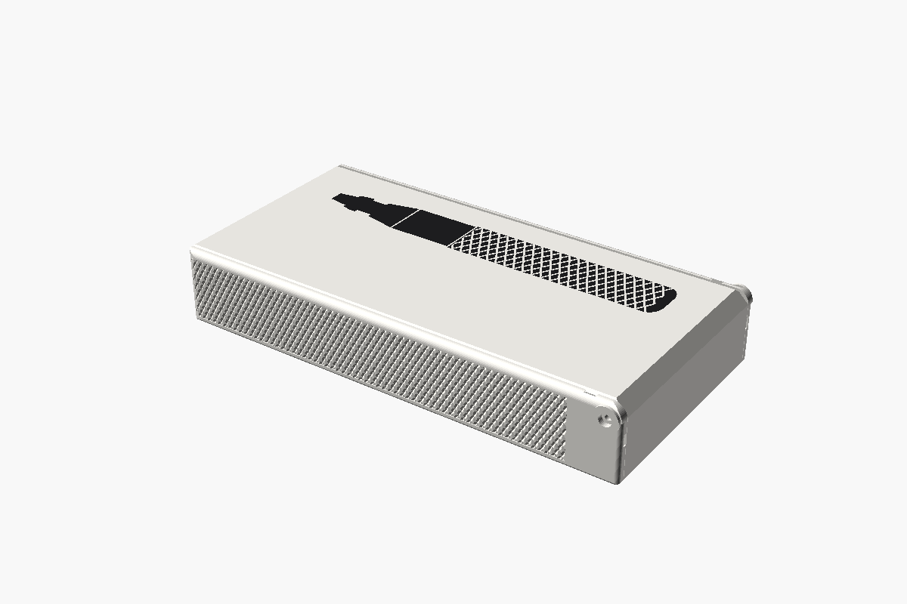
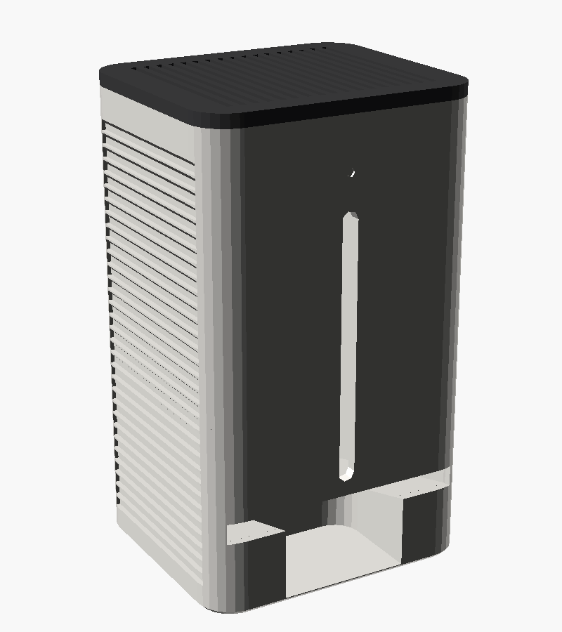
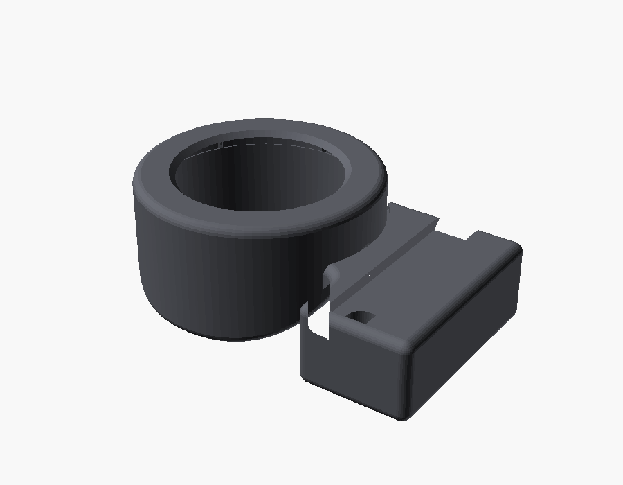
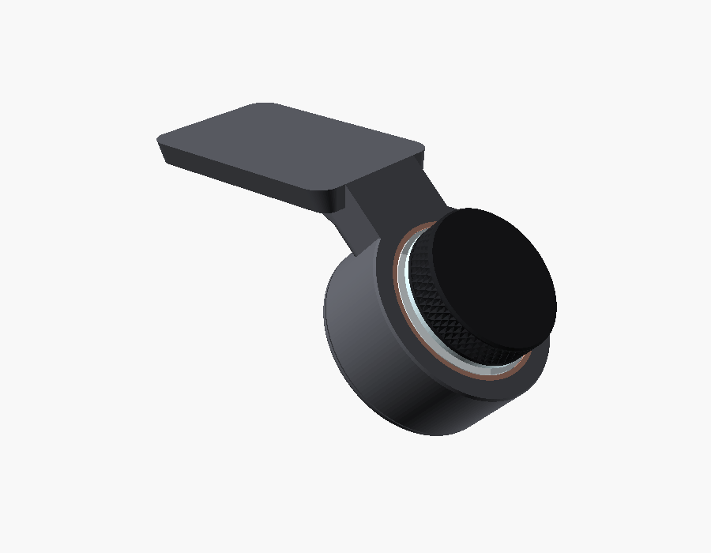
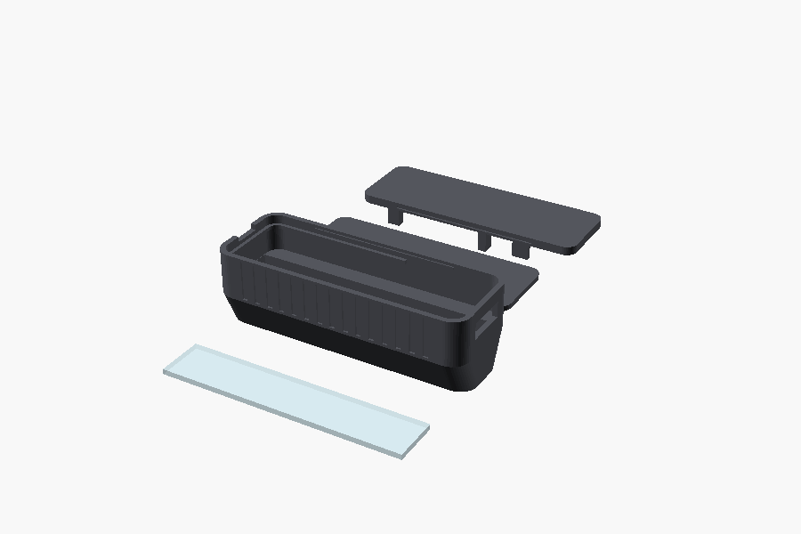
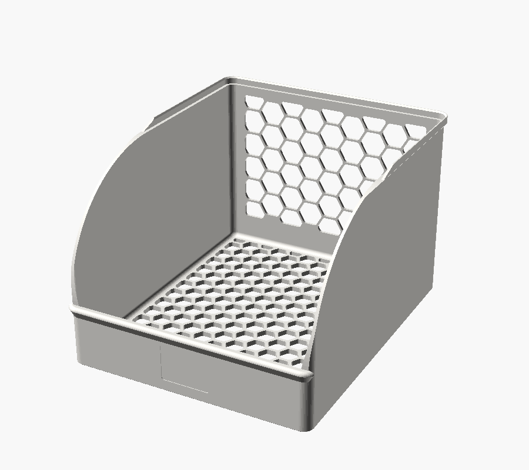

# forge

Parametric 3D-printing projects: OpenSCAD sources, build scripts, and print-ready STL / 3MF files.
Designed and printed on a Bambu Lab P2S (0.4 mm nozzle, AMS).

## Projects

| | Project | What it is | Print this |
|---|---|---|---|
|  | [trim-kit-case](trim-kit-case/) | Hinged case for the Bambu Lab trimming tool kit: 10 snap-in blade seats, a handle clip, a hidden hinge stop that lets it stand open, a magnet latch and two-colour inlays. | `trim_case_print.3mf` (body and lid on one plate, P2S / PETG Matte settings included) |
|  | [lens-wipe-box](lens-wipe-box/) | Desk dispenser tower for individually wrapped lens wipes (plus an earlier box). You pull the bottom wipe out of the front. | `lens_wipe_tower.stl`, `lens_wipe_tower_lid.stl`, `lens_wipe_tower_weight.stl`, `lens_wipe_tower_weight_cover.stl` |
|  | [desk-dial-pod](desk-dial-pod/) | Round pod for a 1.28" round display and a XIAO ESP32S3, off the edge of a monitor at eye level. Slides onto a Command-strip bracket; two-colour accent ring round the window. | `desk_dial_pod.3mf` (whole plate, P2S profile included) |
|  | [desk-dial-knob](desk-dial-knob/) | A rotary-encoder knob in a round head on a neck, gel-taped under a desk. A NeoPixel lights a thin ring of colour at the knob's base. | `desk_dial_knob_housing.3mf`, or the `desk_dial_kh_*.stl` parts |
|  | [desk-accent-case](desk-accent-case/) | Slim case for a XIAO ESP32S3 and an 8-LED stick, stuck under a monitor's edge to light the stand plate. | `desk_accent.3mf`, or `desk_accent_stacked_*.stl` |
|  | [freezer-bin](freezer-bin/) | Open-front stackable bin with honeycomb walls and floor, as deep as a P2S bed will take. Stacked, the front of every bin stays open. | `freezer_bin_print.3mf` (181 g, 8 h 50 m in SUNLU PETG 2.0, P2S profile included); `freezer_bin_cold_test_print.3mf` to freeze first |

Each project folder has a `README.md` (pictures, printing, hardware), a `DESIGN.md` (intent, decisions, fit-test results) and a `Makefile`.

## Printing

Download the 3MF or STL from the project folder and open it in Bambu Studio (or any slicer).
Each project has small fit-test pieces. Print them first if your printer or filament differs from
the one these were tuned on.

STL and 3MF files are stored with [Git LFS](https://git-lfs.com). To clone them, run
`git lfs install` once before `git clone`. Downloading single files from the GitHub web page works without it.

## Building from source

Requirements:
- [OpenSCAD](https://openscad.org) 2025 or later, with the manifold backend.
- Python 3, plus [pytest](https://pytest.org) for the desk-dial projects' `make test`.
- Bambu Studio, for the `trim-kit-case` and `freezer-bin` print files.

```sh
cd trim-kit-case && make          # print file and two-colour halves
cd trim-kit-case && make tests    # fit-test pieces
cd lens-wipe-box && make
cd desk-dial-pod && make && make test     # STLs; geometry checks (needs pytest)
cd desk-dial-knob && make && make test
cd desk-accent-case && make
cd freezer-bin && make && make check     # STLs, print 3MFs, cold test; stacking interference check
```

## License

[CC BY-NC-SA 4.0](LICENSE): free to print, share and remix for **non-commercial** use, with
credit, and remixes must use the same licence. **No commercial use** (selling prints, files or kits,
or using the designs in a product) without a separate licence from the author. For commercial
licensing, contact [@louisalexander](https://github.com/louisalexander).
