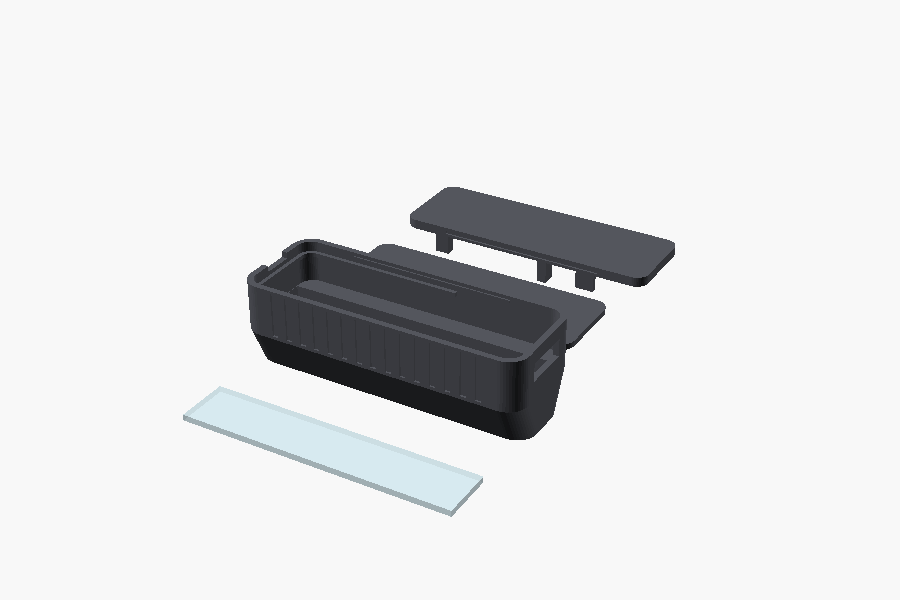

# Desk accent case



A slim case for a XIAO ESP32S3 and an 8-LED WS2812B stick, stuck under the bottom edge of a monitor so the
LEDs light the stand plate below through a frosted window. Rebuild the STLs with `make`, the pictures with `make
images`. Design decisions: [`DESIGN.md`](DESIGN.md).


There are two variants. **Stacked** is the current pick.

## Stacked variant: `desk_accent_case_stacked.scad`

**57.2 × 21.0 × 18.0 mm.** The XIAO sits on a carrier shelf directly above the LED stick. The case
has rounded pill corners, flutes like the CalDigit dock beside the monitor, and a taper from the
narrow LED channel up to full width.

| File | Material | Print |
|---|---|---|
| `desk_accent_stacked_body.stl` | Opaque PLA (black) | Floor down. No supports (the taper is about 25° from vertical). |
| `desk_accent_stacked_carrier.stl` | Opaque PLA | Plate down, pins up. |
| `desk_accent_stacked_lid.stl` | Opaque PLA | Flat face down; posts up. |
| `desk_accent_stacked_window.stl` | **Clear** PLA | On the **textured PEI plate**. The frosted face goes down when assembled. |

Assembly, bottom to top:

1. Window into the floor pocket from inside, frosted face down.
2. Stick LEDs-down on its ledges, with its **input (DIN) end at the USB end**.
3. Carrier onto the steps, with its pins through the stick's holes.
4. XIAO on the carrier, USB-C through the end wall. The three wires rise through the slot at the
   USB end: 5V → 5V, GND → GND, DIN → D0.
5. Snap the lid in. Its posts press the XIAO and the carrier down and stop the XIAO sliding back.
   Pry it open at the notch at the far end.

Verified 2026-11-10 against the build123d model of the same design: the dimensions match, and the
total volume differs only by the XIAO stops, which moved from the carrier to the lid so the
carrier has a flat face to print on.

## Side-by-side variant (the original brick)

A slim bar, **82.4 × 21.8 × 12.7 mm** assembled, stuck under the G9's bottom edge in front of the
stand neck, **window facing down**. The source comes in two equivalent versions: `desk_accent_case.py`
(build123d) and `desk_accent_case.scad` (OpenSCAD). Set `PART` to `body`, `lid` or `window` to
export one part in print orientation, or `all` for an assembly preview:

```
openscad -D 'PART="body"' -o desk_accent_body.stl desk_accent_case.scad
```

Both produce the same parts (checked 2026-11-10: identical volumes and bounding boxes). If you
change a dimension, change it in both.

## Print (Bambu P2S)

| File | Material | Plate / orientation | Notes |
|---|---|---|---|
| `desk_accent_body.stl` | **Opaque** PLA (black) | As exported (floor down) | Any plate. The stick ledges, lid seat and snap beads are short overhangs; no supports needed. |
| `desk_accent_lid.stl` | **Opaque** PLA, same colour | As exported (flat face down; pins and posts point up) | The flat face takes the adhesive against the monitor. |
| `desk_accent_window.stl` | **Clear** PLA | **Textured PEI plate**, as exported | The textured face is the diffuser. It goes **down**, against the body's lip. |

Keep the body and lid opaque: a clear case would glow as a lit bar under the monitor.

## Assemble

1. Drop the clear window into the floor pocket from the inside, **textured face down**.
2. Wire the stick to the XIAO: 5V → 5V, GND → GND, DIN (the input end) → D0.
3. Lay the stick **LEDs down** on the two side ledges, which hold it 4 mm above the window, with
   its **mounting-hole edge toward the side the lid pins land on**. The window's light opening
   is offset to the LED row, not centred.
4. Seat the XIAO in its cradle in the rear bay: USB-C port into the end-wall opening, far edge
   against the two corner stops (which keep a cable push from shoving it inward). Route the
   stick's wires over the gap between the stops.
5. Snap the lid in: it sits flush with the top of the walls on a seat ledge, and a bead on each
   long wall clicks into the groove round its edge. On the way in:
   - its two Ø2.8 mm pins drop through the stick's holes (27 mm apart), and their Ø5 mm
     shoulders clamp the stick onto its ledges;
   - its two hold-down posts press the XIAO's long edges onto the cradle pad.

   To open it, pry at the notch in the LED-end wall.
6. Plug in USB-C and stick the lid face to the monitor's underside, centred over the neck, with a
   Command strip or a removable VHB pad.

If the snap is too stiff or too loose, change `BEAD` (how far the bead stands proud, 0.3 mm now)
and re-export the body.

## Parts it was sized for

- 8× WS2812B 5050 stick, **54 × 10.1 mm** (measured), with two Ø~3.1 mm mounting holes 27 mm
  apart. The hole and LED-row offsets from the bar's centreline (`HOLE_Y`, `LED_Y`) are
  **estimated from a photo**. If the pins miss the holes or the light opening looks off the LEDs,
  measure them and change those two numbers.
- Seeed XIAO ESP32S3, 21 × 17.8 mm. The hold-down posts press 0.1 to 1.1 mm in from the long
  edges, clear of the shield and the antenna connector.
- There's about 150 mm of clear space under the monitor, so height is not a constraint.
