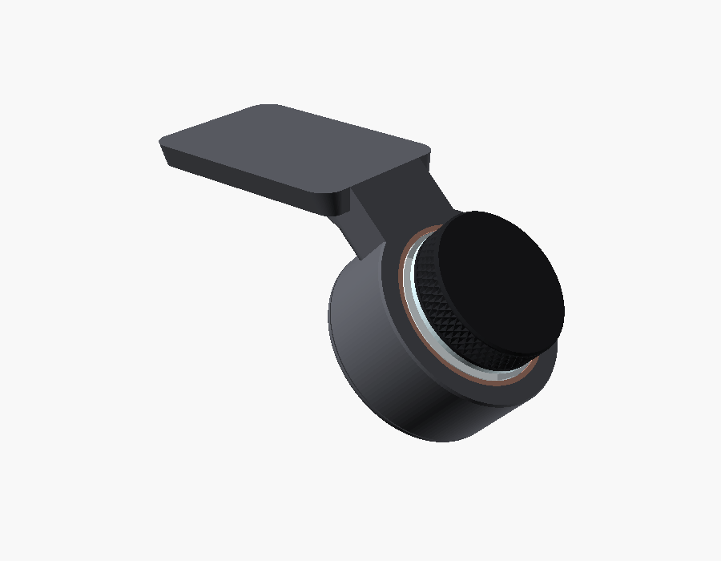

# Desk dial knob

| The knob in its round head, on the neck and plate | From behind: the back cap and the plate |
|---|---|
|  |  |

The Adafruit 5880 encoder and its knob, under the right side of the desk. A **round head** holds the knob
on a 45° face. It hangs from a slim **neck** off a **plate** gel-taped under the desk (no holes). A short **JST-SM
4-pin pigtail** leaves the back of the plate, zip-tied under it; the pod's cable carries the other half. The knob is a black PETG puck whose first 1.5 mm is translucent. The
NeoPixel's light reaches it through a white light cup and a translucent diffuser in the face, so a thin line of
colour shows at its base, inside a rose gold ring. The round head replaced a first,
boxy housing. Design decisions: [`DESIGN.md`](DESIGN.md).

**Status: final.** Every measurement is confirmed against the real parts and the design is locked
(2026-11-21). The STLs here are the ones to print.

Model: `desk_dial_knob_housing.scad`. Re-export with `make`, check with `make test` (pytest), re-render the
pictures with `make images`. It pairs with [`desk-dial-pod`](../desk-dial-pod/): the pod's cable carries the
other half of the pigtail.

## Print (Bambu Studio, P2S + AMS)

**Charcoal PLA everywhere it can be.** The knob comes two ways:
- **Snap knob (try first; the `mockup_knob_*` files):** a **charcoal PLA body** that matches the housing,
  snapped onto a **clear PETG floor**. They print apart, and the joint is a hub round the shaft, inside the
  dark centre. The glow enters the floor's underside between r 12 and 21 and shows at its edge, so the floor
  stays a plain 1.5 mm disc out there and nothing touches the light. The shaft runs through the PETG hub,
  and the hub's outside is a D, so the body turns the shaft.
- **Fused knob (the fallback; `knob_floor` + `knob_body`):** one AMS print, clear PETG floor and black PETG
  body. It's the same shape, but the body can't be PLA, because PETG and PLA don't fuse.

One other part isn't charcoal:
- **The light cup is white PETG** (matte white; ivory PLA also works), because it's the inside of the light box. White bounces the LED's light round
  to the far side of the knob, and charcoal would swallow the glow. It's hidden inside the head.

**Nothing is glued.** Every part is either printed as one AMS object or held mechanically: the cap
screws on, the cup clamps the diffuser, the snap knob clicks together, and the knob pushes onto the shaft. Each STL comes already turned
onto its print face.

| Plate | Objects (`desk_dial_kh_*.stl`) | Filament (AMS) |
|---|---|---|
| 0 · mock-up (optional) | `mockup` | anything, 0.28 mm, face down. Only needed to try a different desk or placement |
| 1 · charcoal | `body` + `accent_ring` **as one object**, plus `back_cap`, `cable_clip`, `mockup_knob_body` | charcoal PLA, rose gold PLA for the ring |
| 2 · white | `light_cup` | matte white PETG (or ivory PLA) |
| 3 · clear | `diffuser_ring` + `mockup_knob_floor` | translucent PETG only |
| (fallback) | `knob_floor` + `knob_body` **as one object** | translucent PETG floor, black PETG body |

**One object, two parts** (plate 1, and the fallback knob): select both STLs, drag them into Bambu Studio together and
answer **Yes** to "load as a single object with multiple parts". Then give each part its filament in the
object list. They share a frame, so they land in place.

**Plate 1 · charcoal PLA**, textured PEI, 0.20 mm, no supports, no brim.
- **Body** face down. The face is the first layer, so it takes the plate's matte texture, like the pod.
  The neck, plate and tie bar rise at 45° from there, and nothing needs supports. The tape face prints as a
  45° slope, which is fine for the gel tape.
- **The rose gold ring** is the face's first 3 layers (0.6 mm), so the AMS only swaps for those. Charcoal
  into rose gold is dark into light: raise that pair's flush volume (about ×1.5) or the ring's first layer
  comes out muddy.
- **Back cap** disc down. **Cable clip** flat side down.
- **Snap knob body** (`mockup_knob_body`) **top down**, so the knob's top gets the same matte plate
  finish as the housing's face. The knurl rises straight up, and the pocket and groove are inside.

**Plate 2 · matte white PETG**, 0.20 mm, the normal PETG profile (textured PEI). The light cup prints **plug down**:
the tapered plug on its back is its own support. It's opaque, so the light bounces forward instead of leaking out the sides. It has its own plate, because
PETG and PLA never share one. Ivory PLA works too, if you'd rather.
- **The wire grooves are on the bed face**, so their roofs hang over the plate. They're shaped to print
  without supports: every groove (the T and the neck groove) is the same ø4.5 teardrop, a round bottom with
  45° sides up to a 1.8 mm flat top, which is a short bridge. No supports and no brim. Keep **elephant foot compensation** on (Bambu's default, 0.15) and a clean plate.
  Overhangs in PETG like a bit of fan: if the roofs droop, raise the overhang fan to 60–80%.

**Plate 3 · clear PETG**, textured PEI (PETG can weld itself to smooth PEI; if you only have smooth, use
glue stick as a release), 0.20 mm, 100% infill, no dark filament on the plate, so nothing tints it.
- **Diffuser** lip down.
- **Snap knob floor** (`mockup_knob_floor`) floor down. The hub with its four slotted fingers rises from
  it. The textured plate frosts the floor's underside, which spreads the glow.

**Fallback knob**, PETG, same plate settings, floor down. The clear floor prints first, so there's **one**
filament change, clear to black, and no black can bleed into the clear.

**Never put PETG and PLA in the same object.** They also shouldn't share a plate: they need different
temperatures.

## Final dimensions (confirmed)

These are measured off the real parts and locked in the model. Change one only for different hardware, then
re-export with `make` and run `make test`.

| What | Parameter | Value |
|---|---|---|
| Shaft diameter | `shaft_d` | 6.0 mm |
| Shaft, flat face to the round side opposite | `shaft_flat` | 4.5 mm |
| Knob bore depth (≤ the shaft's D-flat length) | `bore_depth` | 7.5 mm |
| Board front to shaft tip | `shaft_above_board` | 22 mm |
| Board front to the top of the encoder body | `enc_body_h` | 6.5 mm |
| Threaded bushing | `bushing_d` × `bushing_h` | 7 × 5 mm |
| Board mounting holes (M2.5) | `board_hole_d` | 2.7 mm |
| Tallest part on the board's back (STEMMA QT sockets ~2.9, the clipped encoder pins) | `board_back_h` | 3.5 mm |
| Wiring | `wiring` | `"qt"`: a STEMMA QT cable in a side socket |
| Board orientation | `board_spin` | 0: the NeoPixel toward the chair |
| Connector out of the plate | `connector` | `"pigtail"`: a JST-SM 4-pin pigtail pair |

At `shaft_above_board = 22` the head's back rim sits about 66 mm below the desk.

## Placement (final)

The knob's centre is `knob_out = 20` mm past the desk's front edge and `knob_down = 29.5` mm below its
underside (about 39 mm past the edge, about 66 mm below at the head's back rim). That leaves the 15 mm pinch
room (`finger_room`) between the knurl and the desk corner. The checks also cover a second placement,
30 / 19.5, for a different desk.

## Assemble

1. Solder the male JST-SM pigtail to the pod's cable (match the colours noted at the pod: 3V3, GND, SDA, SCL;
   heat-shrink each joint).
2. **The pigtail, plate → head:** feed the female pigtail's bare ends up through the hole in the plate's
   underside (behind the tie bar), along the plate and down the neck, until they come out of the head's open
   back. Zip-tie the leads to the bar under the plate (a 3.6 mm tie through its tunnel), leaving the plug
   about 10 cm past the plate's back.
3. **Wire the board with a STEMMA QT cable** (`wiring = "qt"`, the final design). The board's two QT
   sockets sit mid-edge on its back, on the left and right edges. Plug the cable into either one and lay the
   board on the posts with the NeoPixel **toward the chair** (`board_spin = 0`). The plug drops into the pocket
   at that side's edge, and the cable goes straight back through the hole there. Behind the cup, bundle the
   four wires 2 × 2 and press them into the T-shaped groove in the plug's face: straight across the middle to
   the centre, then straight up the middle into the neck groove. Keep the QT plug in the head and feed the
   cable's **other** end down the neck: the plug won't pass the ø4.4 channel. Screw the board down **from the
   front** (4 × M2.5 × 6). The heads hold the board, so pulling the knob can't move it. White nylon or
   low-profile heads keep the glow even.

   **Alternative, soldered wiring** (`wiring = "solder"`, then re-export: that cup has a pad slot and no side
   pockets). The 5880's pads run along one edge: **VIN · 3V · GND · SCL · SDA ·
   INT**. Use the middle four, and leave VIN and INT empty. Push the leads through the cup's slot from behind
   (the slot is on the neck side), then solder them into **3V / GND / SCL / SDA** from the board's back, so
   each lead drops straight off its pad into the slot. Lay the board on the posts with that pad edge over the
   slot. The NeoPixel ends up on the opposite edge, toward the chair, away from the wires. Screw it down
   **from the front** (4 × M2.5 × 6), drawing the slack back through the slot. The heads hold the board, so
   pulling the knob can't move it. White nylon or low-profile heads keep the glow even.
4. Push the diffuser's front disc into the face hole from inside, until its lip sits in the pocket behind the
   face. Slide the cup (with the board) in from the back along the knob's axis, shaft through the diffuser.
   The three bosses centre it. Lay the leads in the groove in the plug on its back. It runs straight out to
   the head wall on the neck side, then forward along the wall into the neck.
5. Close the head with the back cap (3 × M2.5 × 8 into the bosses). The cup's tapered plug seats in the
   cone inside the cap's rim, 0.2 mm tight, so tightening the screws centres the cup with no wiggle and clamps
   it onto the diffuser's lip. The notch in the ring lets the wires through.
6. **Snap knob:** the floor's hub (the four slotted fingers) clicks into the **charcoal knob body**, not the
   diffuser. The diffuser stays in the face, and its ø8 hole only lets the shaft through; the knob floor spins
   1.5 mm in front of it. Line up the hub's flat with the flat in the body's pocket and press the floor in until it
   clicks flat against the body: the barb has caught the groove. Then push the knob onto the shaft (flat to
   flat) until it stops. With the shaft inside, the fingers can't flex, so it can't come apart on the shaft.
   Off the shaft, pry it apart at the rim with a fingernail. **Fused knob:** just push it on.

## Install

Clean the desk's underside with isopropyl. Cover the plate's top with nano gel tape, press it up for 30 s,
and let it settle for an hour before using the knob.

**About the tape:** pressing the knob levers the plate's front edge away from the desk:
a 10 N press is about 400 N·mm of peel there. If the gel tape ever creeps or peels, use 3M VHB tape instead (it's removable with floss and heat, but
not reusable). Plug the pigtails together, then stick the cable clip
just behind the plug on the pod's side and press the cable into it, so the cable's weight never hangs on the
joint or the housing.
