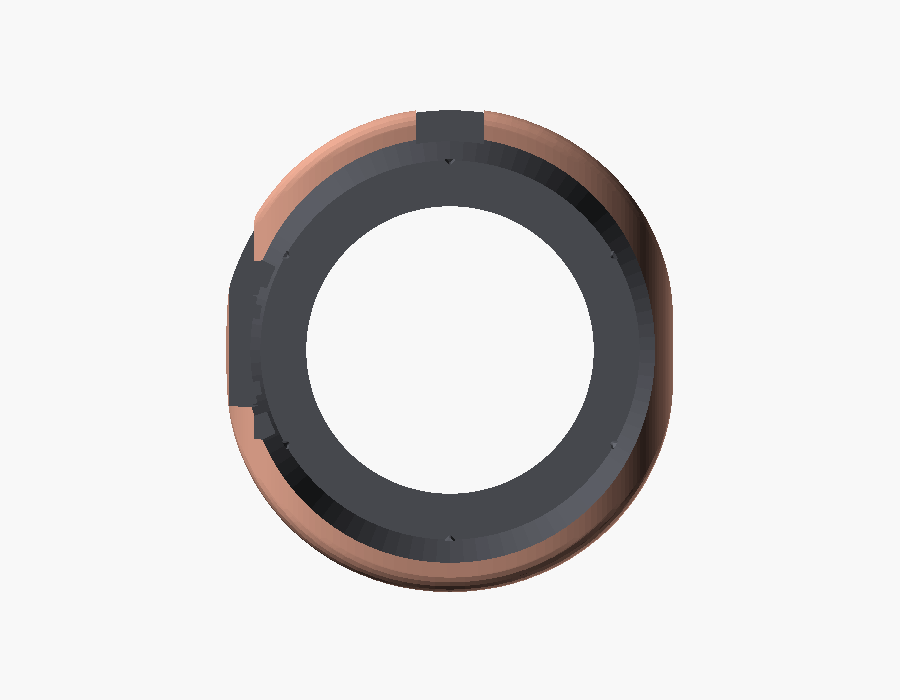
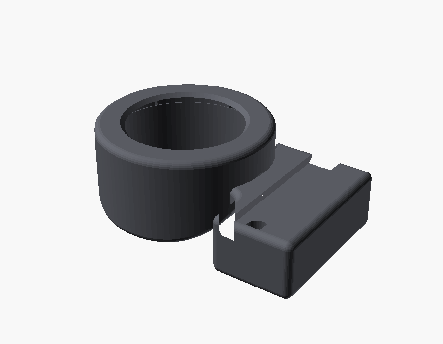

# Desk dial pod

| The round piece, face on (rose gold accent ring round the window) | The whole pod, from behind |
|---|---|
|  |  |


A round grey gauge (ø50.1, `face_shape = "gauge"`: the ø44.1 circle the screen sits in, with a 3 mm rim round it) that sits off the left edge of the Odyssey
OLED G9 at eye level, face flush with the glass, holding the round display + XIAO ESP32S3. It slides onto a Command-strip bracket stuck to
the monitor's back. The firmware and the rest of the dial live in a separate project; this folder is the enclosure. Design decisions: [`DESIGN.md`](DESIGN.md).

| File | What it is |
|---|---|
| `desk_dial_pod.scad` | the parametric model (all parts) |
| `desk_dial_pod_round.stl` | the pod, piece 1: the round gauge, already turned face down for printing |
| `desk_dial_pod_round_body.stl` + `desk_dial_pod_accent.stl` | the round piece as two parts in the same frame, for a **two-colour** print: the body, and the accent ring round the window (see "Print") |
| `desk_dial_pod_root.stl` | the pod, piece 2: the box behind the panel (dovetail slot, magnet, USB-C adapter pocket), already standing on its top for printing. Glue it to the round piece |
| `desk_dial_pod.stl` | the pod in one piece (the root needs supports this way; see "Print") |
| `desk_dial_cap.stl` | the back cap: the screen screws onto its three posts, then cap + screen go into the pod as one unit |
| `desk_dial_bracket.stl` | the bracket the Command strip goes on |
| `desk_dial_fittings_coupon.stl` | a quick test of the two cable fittings: the socket block (USB-C adapter pocket, the socket opening, and the I2C cable's press-in groove) standing on its top as the root prints, and the bottom of the bracket with the cable clip |
| `desk_dial_coupon.stl` | a quick fit-test: edge lip + rail slice and matching pod root (both with magnet pockets), a slice of the real face with its window and seat band, the real back cap, and a socket block (the root round the USB-C adapter's pocket) |

The STLs are for the monitor's **left** edge (`side = "left"`, the default). The model is built
in a right-handed frame where outboard is +x, which on its own is the *right* edge, so the
selector mirrors every part. A left part is the mirror image of a right one. Turning a print over
doesn't give you the other side: upside down, the slot's closed end is at the bottom and the pod
slides off the rail. For a right-edge pod, export with `-D 'side="right"'`.

**Status: final.** Every measurement is confirmed against the real parts, every fit is tuned, and the design
is locked (2026-11-21). The STLs here are the ones to print.

## Looks

Set at the top of the `.scad` under "Looks":

- `window_bevel`: the screen window's front edge is a 45° bevel the full thickness of the face
  skin, so the bezel reads thinner. The back of the window, the lip that holds the glass, is unchanged.
- `accent`, `accent_w`, `accent_t`: the two-colour ring round the window (1.2 mm wide, 0.48 deep).
- `stem_r`: the curve that blends the socket block below the gauge into the round.
- `seam_reveal`, `seam_reveal_d`: the shadow line at the glue seam.
- The root's edges are all rounded (`root_round`, 2 mm). Outboard of the panel edge it is only the
  block round the adapter pocket, so from the front it never stands up past the round's curve.

## Re-export after changing a parameter

```bash
make            # writes the nine STLs above
make test       # geometry checks (pytest)
make images     # the README pictures (render.scad)
```

The checks prove that nothing touches the monitor's panel, the face is flush, the face is the
ø44.1 screen seat plus a 3 mm rim, the face's lip still holds the glass from the front, the cap's tab over
the USB-C plug is at least 2.5 mm thick, the bracket lip stays 2 mm off the glass, every cavity keeps a wall, and the board fits
in from the back. They also check the screen mount: the screw holes match the measured triangle,
each cap post lands on its brass standoff, the cap and pod clear everything on the board's back
(XIAO, USB-C, coin-cell holder), the screws pass freely, and a screw long enough to reach the
glass is refused. And the USB-C adapter fits its pocket pointing at the monitor, with solid plastic
straight above it (the push of plugging the desk cable in lands there, not on the XIAO), the desk
cable's plug reaches up to its socket through the bottom of the pod, and the cable bends inboard
into the bracket's clip, which sits wholly behind the panel. An adapter too long for the pod is refused.
The two pod pieces never overlap, add back up to exactly the one-piece pod, and the slot, magnet
pocket, socket opening and I2C groove are all in the root. The I2C cable is squeezed by its groove
(that is the grip), the model refuses a groove as wide as the cable, and the two cables lie side by
side in the clip without touching each other, the bracket or the pod.

## Final dimensions (confirmed)

Measured off the real parts and locked in the model. Change one only for different hardware, then
re-export with `make` and run `make test`.

**The display** (owner, all from the **front of the glass**): PCB ø42.98, glass ø43, board front 4.8,
standoff tops 8.3, coin-cell holder top 7.8, USB-C centre 16.57, deepest point (the USB-C shell) 18.0. The
screw positions come from Seeed's v1.1 board file and match the measured triangle.

| What | Parameter | Value |
|---|---|---|
| The XIAO's USB-C opening, from the board's centre | `usb_mouth_bx` | 21.0 mm |
| Right-angle (side-bend) USB-C adapter: plug's outer edge to the socket face | `adp_plug_to_socket` | 21 mm |
| Adapter block, across (along the plug) / thickness / front part | `adp_w` / `adp_t` / `adp_t_front` | 18.5 / 8.1 / 3.5 mm |
| Adapter: plug mouth to the socket's centre | `adp_socket_x` | 12.0 mm |
| Adapter: how far the block reaches past the plug's edge | `adp_above_plug` | 1.5 mm |
| Adapter fit, per side / gap behind it to the cap | `adp_fit` / `adp_cap_gap` | 0.35 / 0.4 mm |
| How far up inside the pod's bottom the socket sits | `socket_recess` | 1.5 mm |
| The desk cable's moulded plug / cable | `desk_plug_w` × `desk_plug_t` × `desk_plug_len` / `usb_cable_d` | 13 × 7 × 15 / ø4.5 mm |
| PCB thickness | `pcb_t` | 1.2 mm |
| Monitor depth at its edge | `edge_thickness` | 5.65 mm |
| Command strip pad | `strip_w` × `strip_l` × `strip_t` | 19 × 70 × 1.6 mm |
| Pod depth | `pod_depth` | 25.6 mm |

**Tuned fits** (from the coupons, locked):

| Fit | Parameter | Value |
|---|---|---|
| Screen seat band / crush-rib circle | `board_seat_d` / `seat_rib_d` | ø44.1 / ø43.1 (six ribs), `seat_len` 4 mm |
| Pod on the bracket's dovetail rail | `slide_clearance` | 0.25 mm |
| Lip to the monitor's side frame | `edge_gap` | 1.0 mm |
| I2C cable groove: entry / squeeze on the jacket | `i2c_snap_w` / `i2c_grip` | 3.6 / 0.2 mm |

## Print (Bambu Studio, P2S)

**The print file: `desk_dial_pod.3mf`.** One plate with the round piece (body + rose gold accent ring, as one
two-part object), the root, the bracket and the cap, with the P2S profile embedded (`print_settings.config`).
Open it, check the filaments map to your AMS slots (1 = main, 3 = the accent), and print. About 3 h.
Rebuild it with `make print` after any change.

- **The cap's supports are made to come off easily:** organic tree supports, 0.6 mm tips, 0.6 mm clear of the
  part's sides, and a sparser interface. The other objects keep the project's supports, and the bracket has
  none. Snap them off by hand; nothing needs cutting.

- **Filament:** Ash Gray PLA (AMS slot 3).
- **Pod, two pieces (recommended):** the round gauge and the root print separately, then glue
  together, so neither needs supports. Both STLs come already turned onto their print faces.
  - `desk_dial_pod_round.stl` prints **face down on the textured PEI plate** (the matte finish),
    0.16 mm layers. It is a dome, so every layer sits inside the one below: no supports.
  - **Two-colour (accent ring):** instead of `desk_dial_pod_round.stl`, select
    `desk_dial_pod_round_body.stl` and `desk_dial_pod_accent.stl` together and drag them into Bambu
    Studio; answer **Yes** to "load as a single object with multiple parts". Give the body the main
    filament and the accent part the second one. The ring is the first 3 layers (0.48 mm at 0.16), so
    the AMS swaps only for those. It also wraps over the top of the window's bevel, so the colour
    outlines the screen.
  - `desk_dial_pod_root.stl` prints **standing on its flat top**, 0.20 mm layers, no supports. The
    dovetail is then drawn whole in every layer (clean sliding faces, nothing to sand off), the
    slot's closed end sits on the bed, and the adapter pocket's ceiling, which takes the push of
    plugging in, prints as a solid floor.
- **Pod, one piece:** `desk_dial_pod.stl`, face down on the textured plate, 0.16 mm. The root then
  hangs about 30 mm out, 9 mm off the bed, so it needs tree supports with a support interface layer.
  Those supports touch the slot's sliding faces, so clean them and re-check the slide.
- **Cap and bracket:** 0.20 mm layers. Print the cap flat side down. Print the bracket with its
  strip pocket facing up.
- **Coupons (optional):** only to re-tune the fits for a different printer, filament or hardware. 0.20 mm,
  about an hour. The fit coupon holds five pieces: in Bambu Studio use
  *Split to objects*, then lay each one on its flat face. The face ring goes face down (like the
  pod), the cap goes with its back down, the socket block with its open back up.

## Fit tests (optional)

The fits above are tuned and locked. These steps are only for re-tuning them on a different printer, filament
or hardware.

### The cable fittings

Print `desk_dial_fittings_coupon.stl` (0.20 mm, two pieces: in Bambu Studio use *Split to
objects*; the socket block already stands on its cut top, lay the clip piece like the bracket).

1. **USB-C:** drop the adapter into the pocket from the open back, socket down. Plug the desk
   cable up into it from below: it should go fully home without the adapter lifting.
2. **I2C cable:** press a length of the 24/4 cable into the groove from the back with your thumb.
   It should snap in past the lips and stay put when you tug it along its length. Won't go in:
   raise `i2c_snap_w` (3.6) by 0.2. Slides when tugged: raise `i2c_grip`
   (0.2, how much the groove squeezes the jacket) by 0.1. Pops out the back: lower `i2c_snap_w`.
3. **Clip:** press both cables into the clip side by side, USB-C on the monitor side. Both should
   go in and stay without kinking.

### The fit coupon

1. Press the lip piece against the monitor's left edge. It should sit snug against the side
   frame and never touch the glass. Adjust `edge_gap` if needed.
2. Glue a magnet into each pocket first (see "Magnets" below). Then slide the root piece down the
   rail. It should go on with almost no force and pull itself in at the bottom. Stiff along the
   whole slide: raise `slide_clearance` (0.25); sloppy: lower it. There is deliberately no snap
   bump. A rigid bump can't flex: the first one gave no click and the next one snapped off, and
   forcing a pod over one pries the bracket off its Command strip.
3. Press the display into the **face ring**, glass first. It should be snug and sit flat against
   the face, with the screen centred in the window. The ring is the pod's real face: a seat band of
   `board_seat_d` (44.1 since 2026-11-13: 43.1 was so tight the two-colour round came apart taking
   the screen out), `seat_len` (4 mm) deep, then the loose bore. The band itself no longer touches the
   screen: six **crush ribs** stand out of it, their tips on the ø43.1 circle (`seat_rib_d`) round the
   window centre, so they centre the screen exactly while only their narrow tips grip. Loose: lower
   `seat_rib_d` by 0.05. Won't go in, or too hard to get out: raise it. Screen off-centre in the window: the board's
   position in the model is off; move it the other way.
4. Screw the display onto the **cap**: three M2 × 14 pan-head screws from the cap's back into the
   brass standoffs. Each post should land flat on its standoff, the screws should bite without
   bottoming out, and nothing on the board (coin-cell holder, XIAO) should touch the cap. A gap
   between a post and its standoff, or a screw that spins without pulling tight, means a depth is
   off: re-measure standoff and glass depths.
5. Drop the USB-C adapter into the **socket block** from its open back, plug pointing at the
   cut-off end, socket down. It should be snug with no rattle (`adp_fit`, 0.35 per side). Plug the desk
   cable up into it from below: it should go fully home without the adapter lifting, and come out
   without the adapter following it.
6. Re-export and re-run the tests. Repeat until it fits.

## Magnets

Two **6 × 3 mm N52 neodymium discs**: one in the rail's tip face, one in the slot floor of the pod.

1. Stack the two magnets so they attract, and mark the two faces that touch each other with a
   marker. Those marked faces go **outward**, facing each other across the slide.
2. Put a drop of CA glue (superglue) or epoxy in each pocket and press the magnet in, marked face
   out. It sits 0.2 mm below the surface so the faces never scrape. Let it cure before sliding.
3. Check the polarity before the glue sets: hold the pod root near the rail. It should pull in,
   not push away.

The pod's magnet sits 0.25 mm higher than the rail's when seated, so their pull to line up holds
the pod **down** on its stop. Lifting it off is a straight pull up, which loads the Command strip
in shear, the direction it's strongest.

## Glue the two pod pieces

The root's curved seat wraps the round piece's inboard back, so the pair only fits together one
way. The seat stands 0.1 mm off the shell all round (`split_gap`) to leave room for glue. At the
outside the root steps back a further 0.5 mm for its last 1 mm (`seam_reveal`, `seam_reveal_d`): a
deliberate shadow line, so the seam reads as designed and a little glue squeeze-out hides in it.

1. Dry-fit first: nest the round piece into the root's seat, backs down on a flat table. Then push
   the back cap in. Its tab over the adapter crosses the seam, so a cap that goes in flush means
   the two pieces are true.
2. Pull the cap out, run thin CA glue or epoxy along the seat, and keep it off the last 4 mm at the
   back (that is where the cap sits). Press the pieces together, backs on the table, and push the
   cap back in dry while it sets, to hold them true. Take the cap out before the glue squeezes into
   it.
3. Glue the pod's magnet into the slot floor after this (see "Magnets").

## Assemble and install

1. Cut the 24 AWG 4-conductor cable to length: the run goes from the pod across behind the monitor
   to the knob under the right side of the desk, so measure it along its real path and add 20 cm.
   At the pod end, strip about 25 mm of jacket and solder the four wires to the XIAO: 3V3, GND,
   SDA (D4) and SCL (D5). Note which colour went where for the knob end. Plug the right-angle adapter
   into the XIAO's USB-C, socket pointing down (seen with the screen facing you, USB-C on the right).
2. Screw the board onto the cap: three **M2 × 14 pan-head** screws from the back of the cap,
   through its posts, into the brass standoffs. Snug, not tight: the posts are plastic.
3. Slide cap + screen into the back of the pod, screen first, with the adapter going into its
   pocket on the monitor side and the bare wires through the window at the top of the I2C groove.
   Then press the cable's jacket into the groove from the back, from the window down to the pod's
   bottom: it snaps in past the lips and is gripped all the way, so a tug on the cable never reaches
   the solder joints. The cap sits flush and clamps the adapter; to take it out, push a flathead into
   the slot in the pod's bottom rim (bottom centre, at the back), hook its tip under the cap's lip in
   the undercut behind the slot, and rock the handle down on the slot's front edge: the cap lifts out. The cable is permanent: to take the pod to the bench, the knob comes too. Reflash
   over Wi-Fi, or through the pod's own USB-C socket.
4. Clean a patch of the monitor's back near the top-left corner with isopropyl alcohol.
5. Stick the strip into the bracket's pocket. Hold the bracket at eye level with its lip against
   the monitor's left edge and press for 30 s. Wait an hour before loading it.
6. Slide the pod down onto the rail until the magnets pull it in. Don't push it on. Plug the desk
   cable up into the socket in the pod's bottom (support the pod from above as you push), then
   bend it inboard and press it and the I2C cable into the clip under the bracket, side by side
   (USB-C on the monitor side). Run them down
   the back of the monitor. From the chair they're hidden behind the panel. Any length of USB-C
   cable works; to lift the pod off, unplug it first.

---
