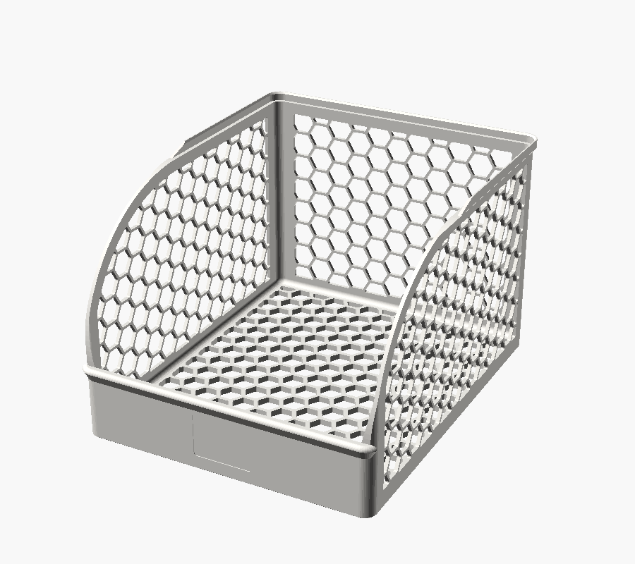
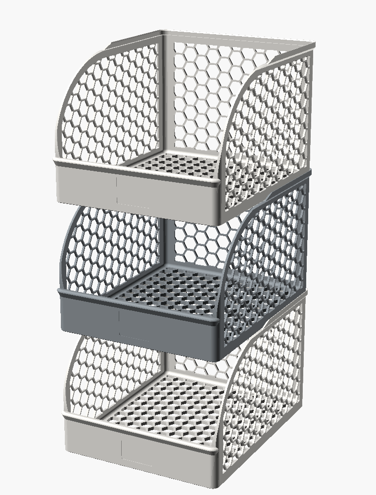
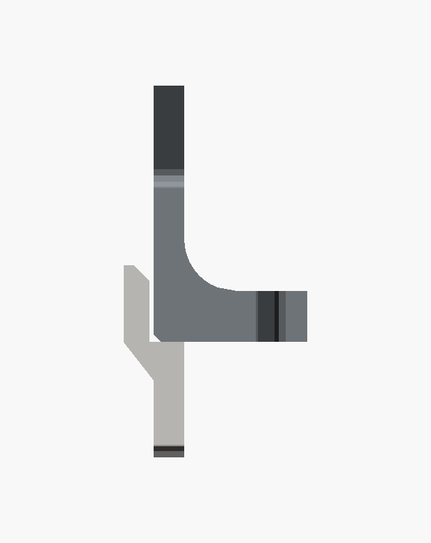
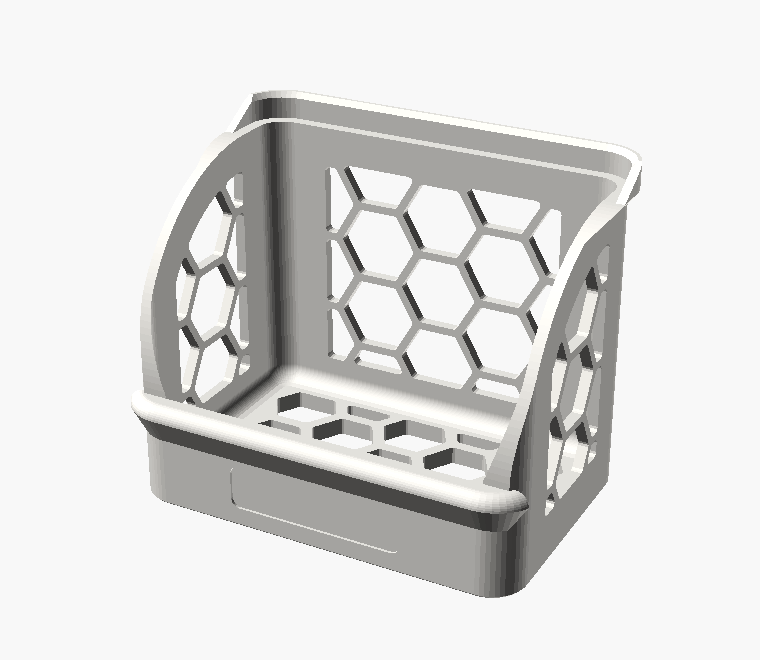

# Freezer bin

| One bin | Three stacked | The rim joint, in section |
|---|---|---|
|  |  |  |

| The cold test piece |
|---|
|  |

An open-front stackable storage bin with honeycomb walls and floor, sized to the biggest footprint
a Bambu P2S bed will take. Stack them and the front of every bin stays open, so you can reach into
the bottom one without lifting the stack apart.

Rebuild the STLs with `make`, the pictures with `make images`. Design decisions and the filament
numbers behind the default cell size: [`DESIGN.md`](DESIGN.md).

## Size

**204.7 × 251.35 × 156.0 mm** overall. The body is 200 × 246 × 150; the rest is the stacking
flange around the rim, which stands 6 mm above it, and the grab rail standing 3 mm proud of the
front.

- **Stack pitch 150 mm.** Bins sit wall-on-wall, so three of them stand 456 mm tall.
- **Front opening 100 mm.** The lip is 50 mm high, so a stacked bin leaves 100 mm of clear access
  into the one below.
- **Capacity** about 6.9 L to the rim, of which about 2.2 L is below the front lip. Anything loose
  above that line can roll out the front — raise `front_h` if that matters more than access.
- **Grab rail** along the top of the front lip: a rounded 5.4 mm face to pull on instead of a
  2.4 mm edge, which also stiffens that span.
- **Label pocket** 40 × 30 mm, 0.6 mm deep, in the front face.

### Placing it on the bed

Centred is correct. The P2S printable area is 256 × 256 and it has **no exclusion zone** — its
profile sets `bed_exclude_area: []`, explicitly clearing the 28 × 28 front-left corner and 8 mm
left strip it would otherwise inherit from `fdm_bbl_3dp_001_common`. Older Bambu machines keep
that L; this one does not, so nothing has to be moved out of the way.

Centred, the bin sits at X 25.6–230.4 and Y 2.3–253.7: about 25.6 mm spare each side in X, and
**2.3 mm front and back**, which is the tight dimension. `freezer_bin_print.3mf` places it there
already, and `pack_plate.py` reads the bed geometry out of the machine profile rather than
assuming it, so pointing it at an X1 or P1 profile would shift the part clear of their L.

**Print it without a brim** — the flat 200 × 246 bottom does not need one, and there is no room
for one front or back. If you would rather have the margin than the depth, drop `depth` to 243 and
the overall goes back to 248.35 mm.

## Print

| File | Material | Print |
|---|---|---|
| `freezer_bin.stl` | PETG or PLA | Bottom down, as exported. **No supports.** The honeycomb cells are flat-topped, so each hole's sides stand at 60° from horizontal and its roof is a short flat that bridges; the wall flares out to the flange at about 38° from vertical. |
| `freezer_bin_stack_test_top.stl` | same | Fit test — a corner of the rim and flange, already in its printed orientation. ~8 g. |
| `freezer_bin_stack_test_bottom.stl` | same | Fit test — a corner of the floor. ~23 g. |
| `freezer_bin_cold_test.stl` | same | **Cold test** — a small bin, every feature at full size. Print two. |

### Ready-made Bambu Studio files

| File | What it is |
|---|---|
| `freezer_bin_print.3mf` | The bin, placed, with the P2S / SUNLU PETG 2.0 profile embedded. **186 g, 9 h 14 m.** |
| `freezer_bin_cold_test_print.3mf` | Two cold-test bins on one plate. **71 g, 3 h 6 m.** Print this one first. |

Open either in Bambu Studio and slice — the plate, filament and process are already set. The
filament profile is called **SUNLU PETG 2.0 @BBL P2S 0.4 nozzle**: 245 °C nozzle (250 first
layer), 70 °C textured plate, 0.95 flow, 12 mm³/s volumetric cap, 1.27 g/cm³. Bambu ships a SUNLU
PETG profile but only for the A1, A1M and X1C and nothing for PETG 2.0, so this takes the P2S
PETG profile for the machine-specific values that have to be right and lays SUNLU's own material
numbers over it. `make print` rebuilds both files; `print_profile.py` has every value and its
reason.

If you would rather set it up yourself: 0.20 mm Standard, textured PEI, **no brim**, no supports.
Everything else is the system default — see `DESIGN.md` for the settings that were tried,
measured and rejected.

PETG is the right material for a freezer. It stiffens as it cools and stays usable at −20 °C,
where PLA turns brittle. Nothing in the design needs changing for the cold: both bins in a stack
contract by the same ~0.7 mm over 246 mm, so a fit test done on the desk still holds in the
freezer.

## Cold test

Before committing 186 g and nine hours, freeze a small one. `freezer_bin_cold_test.stl` is
**94.7 × 65.35 × 76 mm**; two of them are 71 g and about three hours, and
`freezer_bin_cold_test_print.3mf` has both on a plate ready to slice.

It is not a scale model. Everything that decides whether this survives −21 °C is left at full
size — 2.4 mm wall, 16 mm cells on 1.8 mm webs, 4 mm perforated floor, 4 mm floor fillet, 2 mm
flange, 0.35 mm stacking clearance, the grab rail, and a label pocket that thins the lip to
1.8 mm just as the full one does. Only the overall box shrinks. Scaling the whole model would
have thinned the walls and closed the stacking gap, and then it would be testing a different
object.

Print two, leave them in the freezer overnight, then — while they are still cold, because they
warm up fast:

1. **Stack them.** Does the flange still take the other bin, and does it come apart again? This is
   the `stack_clear` check at temperature.
2. **Load one and lift it by the rail.** That is the pull the front lip and the label pocket were
   sized for.
3. **Press a wall in with a thumb**, and flex the floor. You are feeling for a crack or a crunch,
   not for stiffness — cold PETG is stiffer, not weaker, until it breaks.
4. **Drop something frozen into it** from a hand's height onto the floor, over a hole rather than
   a web.
5. **Knock the flange sideways.** It is the most exposed thin feature on the part and the first
   thing that should fail.

Anything that cracks, say which feature and I can thicken it. Nothing cracking is a reasonable
green light for the full print.

### Fit test

Print `stack_test_top` and `stack_test_bottom` and sit the bottom piece's corner inside the top
piece's flange. It should drop in under its own weight and have no sideways rattle. The gap is
`stack_clear`, 0.35 mm per side; raise it if the pieces bind, lower it if they are sloppy.

## How the stacking works

The top of each wall flares outward and carries on upward as a 2 mm flange standing 6 mm proud of
the rim. The bin above drops inside that flange and lands wall-on-wall on the rim, so the outer
faces stay flush and the stack cannot creep sideways. The section picture shows it: light is the
lower bin, dark is the one sitting on it.

The flange only runs where the rim is at full height — around the back and up the sides as far
forward as the sweep — and it fades out over 18 mm so it grows out of the rim rather than ending in
a step. Across the open front there is nothing to rest on, so the front of each floor cantilevers
over the bin below. The side walls and the front lip act as downstand beams along that edge, which
is what keeps it stiff.

`make check` proves the two bins share no volume: it intersects a bin with the bin stacked on it
and the result must be empty.

## Changing it

Everything is at the top of `freezer_bin.scad`. The ones worth knowing:

| Parameter | Default | What it does |
|---|---|---|
| `width`, `depth`, `height` | 200, 246, 150 | Outer body. `depth` is what the bed limits. |
| `front_h`, `slope_run` | 50, 110 | The front lip, and how far back the sweep rises to full height. |
| `front_curve` | `true` | The quarter-ellipse sweep. Set `false` for a straight diagonal. |
| `hex_af`, `hex_web` | 16.0, 1.8 | Wall cell size and the material between cells. **The main filament knob.** |
| `floor_hex` | `true` | Perforate the floor. Turn off for a solid floor — costs about 47 g. |
| `front_hex` | `false` | Perforate the front lip too. Saves about 12 g and loses the label face. |
| `stack_clear` | 0.35 | Flange to the bin above, per side. |
| `fillet_r` | 4.0 | Radius where the floor meets the wall. Costs nothing to print; see below. |
| `rail_w`, `rail_h` | 3.0, 9.0 | The grab rail: how far it stands proud of the front, and how tall. |
| `label_w`, `label_h` | 40, 30 | Label pocket. Set `label_w = 0` for a plain front. |
| `cold_test` | `false` | `true` shrinks the box to the 95 × 65 × 76 test piece, features unchanged. |

The weights above are in SUNLU PETG at 1.27 g/cm³. Bambu PETG Matte is filled and runs 1.37, so
the same bin in that filament is about 201 g rather than 186 g — same plastic, denser filament.

Cell size is worth understanding before you print several. At the original 9 mm cell with a solid
floor the bin is a **295 g, 13 h 32 m** print; the defaults make it **186 g, 9 h 14 m**. `DESIGN.md`
has the sliced weight of every combination tried.

Two details are load-bearing rather than decorative, and `DESIGN.md` has the measurements behind
both. The cells are **flat-topped**: turned the other way up their roofs fall to 30° from
horizontal, which put 11.7% of the wall surface into overhang and dropped 22 m of extrusion to the
slicer's 10 mm/s unsupported speed. And the floor-to-wall **fillet** replaces a sharp internal
corner that would otherwise be the highest-stressed line in the part — which matters because cold
PETG is notch-sensitive.

## Build

```sh
make            # images, freezer_bin.stl, the fit tests and the cold test
make check      # stacking interference check -- must print "PASS"
make images     # README pictures -> img/*.png
make tests      # just the fit-test and cold-test pieces
make print      # the two Bambu Studio 3MFs (needs Bambu Studio)

openscad --backend=manifold -D 'part="bin"' -o out.stl freezer_bin.scad   # any single part
```
