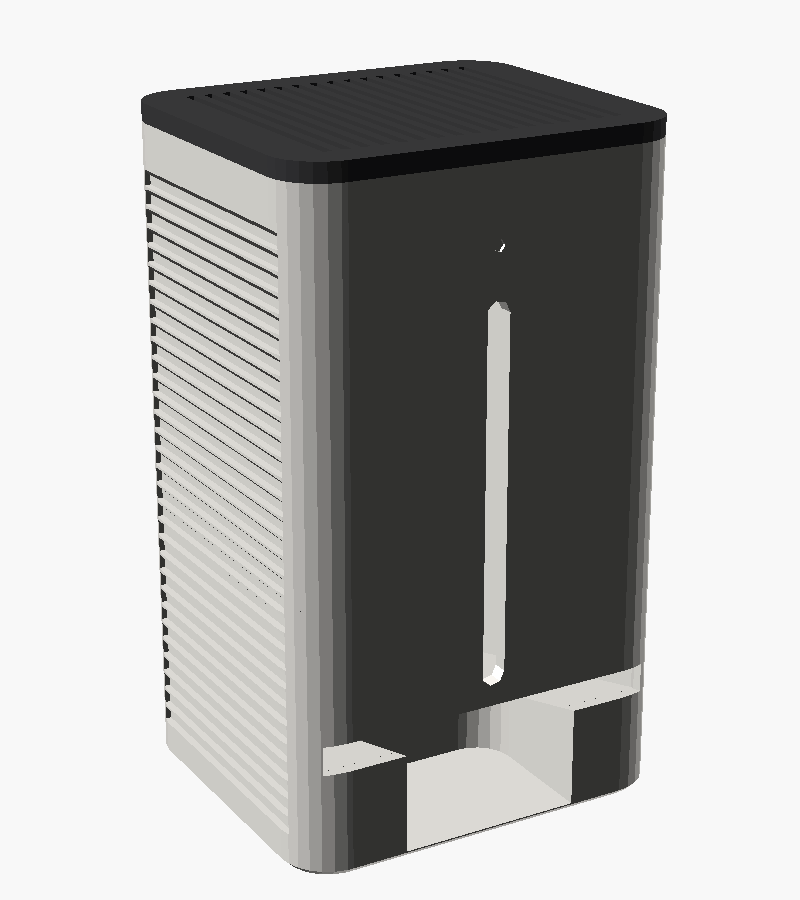
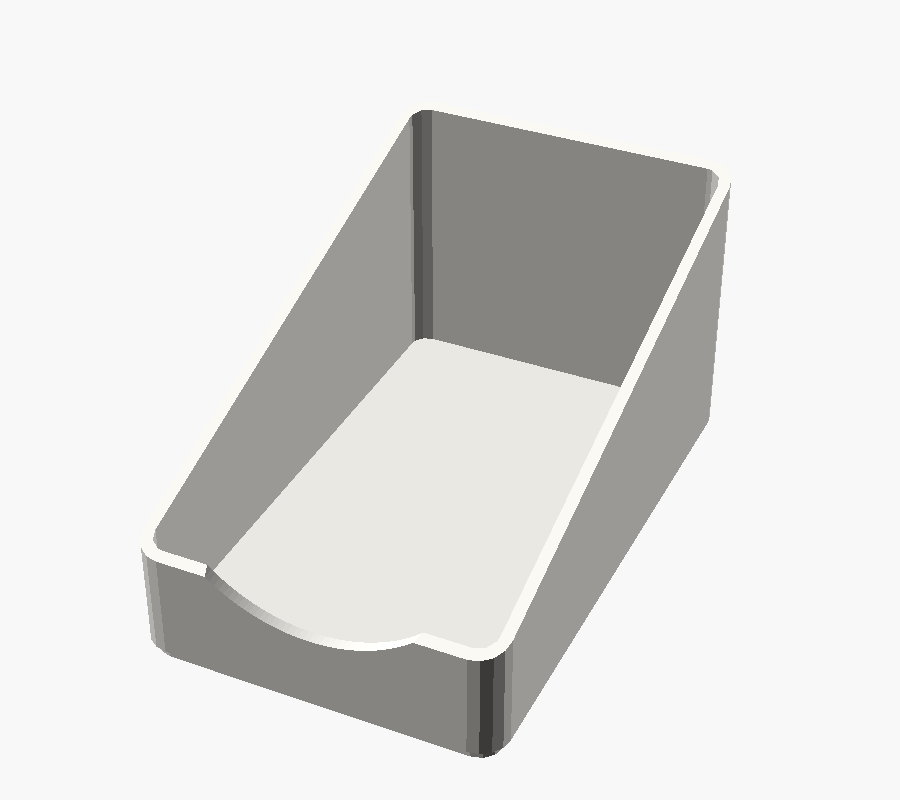

# Lens-wipe dispenser

A desk dispenser for individually wrapped lens wipes (55 × 50 × 3.5 mm packets, such as Zeiss).
Load the wipes in a stack through the top, then slide the bottom one out through the front with one finger.

| Dispenser tower | Earlier open tray |
|---|---|
|  |  |

## Tower

- Holds 27 wipes. A window up the front shows how many are left.
- The floor inside tilts 15° up toward the front. This lifts the bottom wipe's front edge over a finger pocket, so it's easy to grab. The pull slot lets only one wipe out at a time.
- A drop-in grooved lid sits on top. A weighted follower plate rests on the stack and keeps it pressed down.
- Prints without supports. It's about 69 × 62 mm and 125 mm tall.

| File | Part |
|---|---|
| `lens_wipe_tower.stl` | Tower |
| `lens_wipe_tower_lid.stl` | Lid |
| `lens_wipe_tower_weight.stl` + `lens_wipe_tower_weight_cover.stl` | Follower plate: fill it with coins or washers, then add the cover |
| `lens_wipe_tower_fit_test.stl` | The bottom 30 mm only: tests the ramp, slot and finger pocket before the full print |

## Box

`lens_wipe_box.stl` is the earlier design: an open tray with a finger cut-out. `lens_wipe_box_fit_test.stl` is a short ring for checking the packet fit.

## Building from source

```sh
make           # all STLs and the images
make images    # just the pictures above (render.scad)
```

Each part is a `part=` setting of `lens_wipe_tower.scad` or `lens_wipe_box.scad`. All dimensions are parameters at the top of the file. Design notes are in `DESIGN.md`.

## License

[CC BY-NC-SA 4.0](../LICENSE): non-commercial use only. For commercial licensing, contact the author.
