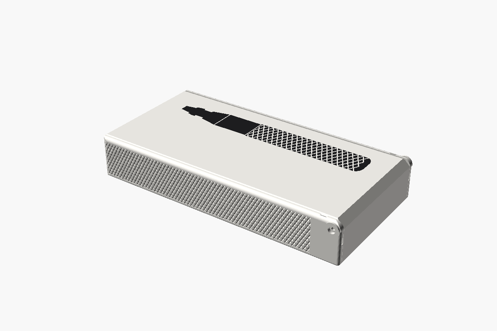
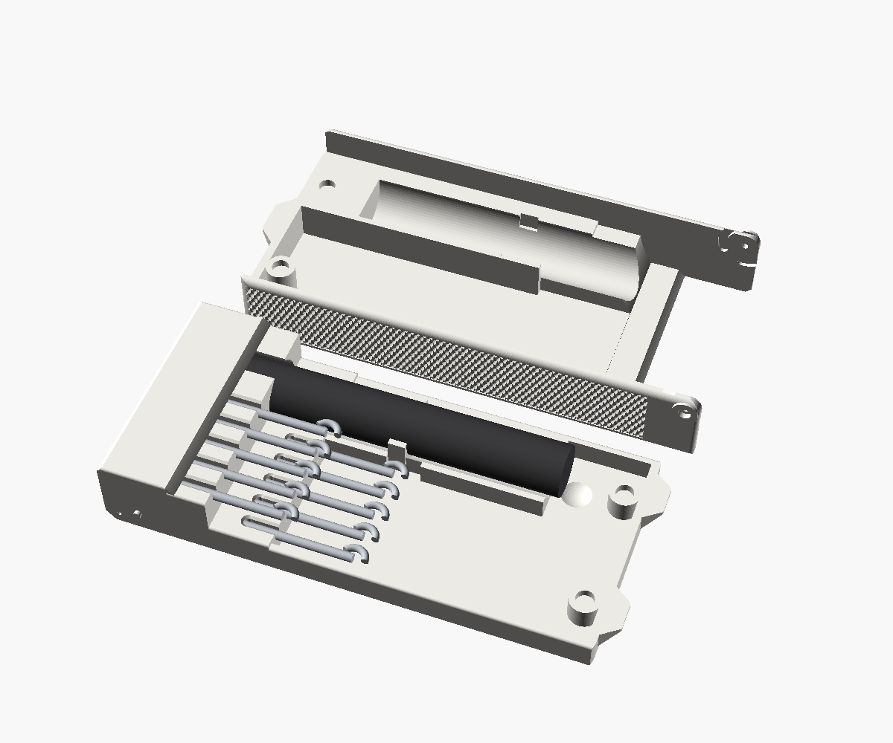
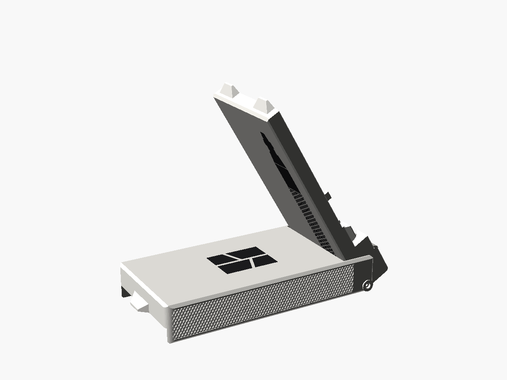

# Trimming-kit case

A hinged case for the Bambu Lab trimming tool kit. It holds the handle and all 10 blades, closes with
magnets, and folds back onto its hinge stop to stand open on the desk.



| Open, with the blades and handle in place | Standing open on the hinge stop |
|---|---|
|  |  |

## Features

- **10 snap-in blade seats** in two stepped rows. Each seat is a 2.9 mm slit over a Ø3.2 channel, with a Ø3.12 keyhole at the deep end. Push the blade's shank tip-first into the keyhole, then pivot the blade down through the slit until it snaps in.
- **Handle clip:** the handle's bottom end goes into the tunnel in the riser, then you press the handle into the clip. The clip sits just above the knurled grip, so the handle can't slide when the case is upside down. A finger scoop past the handle tip helps you lift it out.
- **Screw hinge with a hidden stop:** the lid swings to 300° and stops there, so the case stands open, reclined about 30° past upright.
- **Magnet latch** with grip tabs, a knurled finish on the sides and a two-colour inlay: the handle silhouette on the lid, the logo on the bottom.
- Prints without supports. Closed size: 168 × 84 × 28 mm.

## Printing

Open **`trim_case_print.3mf`** in Bambu Studio and use the settings saved in the project. It holds the body and lid on one plate, each with its inlay, tuned for a P2S (0.4 nozzle, AMS) with PETG Matte on a textured PEI plate:

- Filament 1 is the case and filament 2 the inlays. Map them to your AMS slots.
- Built-in settings for clean inlays: 0.2 mm layers, first-layer line width 0.42, Arachne walls, elephant-foot compensation 0, first layer at 25 / 40 mm/s, avoid crossing walls, Spiral Lift z-hop and a prime tower.
- About 4 h 18 m, 130 g + 2.5 g.
- Use a clean plate: wash it with dish soap and don't use glue stick. The bed face is the face you see.

You can also print the halves separately with `trim_case_body_2color.3mf` and `trim_case_lid_2color.3mf`, or as single-colour STLs.

### Hardware

- 2 × M2 × 8 screws (the hinge, one on each side)
- 4 × Ø6 mm disc magnets: two in the body and two in the lid. The pockets are Ø6.2 × 2.8 deep. Check the polarity before you glue them in.

### Fit tests

Print these first if your printer or filament is different:

| File | Tests |
|---|---|
| `trim_case_keyhole_test.3mf` | Blade seats: rows marked 2.9 K (the chosen size) and 3.0 K |
| `trim_case_clip_test_0.3.stl` | Handle clip (0.3 mm squeeze) |
| `trim_case_hinge_test_body.stl` + `trim_case_hinge_test_lid.stl` | Hinge, screws and stop |

## Building from source

`trim_case.scad` is the whole design, with every dimension a parameter at the top. You need OpenSCAD with the manifold backend and Python 3. Bambu Studio is needed only for the print file.

```sh
make           # trim_case_print.3mf and the two-colour halves
make tests     # fit-test pieces
make images    # the pictures above (render.scad)
make check     # checks that the closed halves meet only at the seam
```

The logo inlay needs `ref/bambu-lab.svg`, which is not in this repo (see [ref/README.md](ref/README.md)). Without it, the case builds without the logo.

`DESIGN.md` records the design decisions and every fit test.

## License

[CC BY-NC-SA 4.0](../LICENSE): non-commercial use only. For commercial licensing, contact the author.
